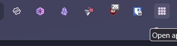

# zenedit
zen browser configurations
compatible with zen browser latest Version 1.24.1b
 

  
  
  
  
  
  

 

## Macos style button right side

  
  
     

 

  
   
  

## Icons added
- [x] **Application Menu Button**

   <figure>
    
  </figure>
   
  <figure></figure>

## Instructions
- Type `about:support` in the address bar and press Enter.
- Look for the `Application Basics` section.
- Click on Open Profile Folder. In the Profile Folder, create a new folder and name it `chrome`. Make sure to download theme zip file from github(or google it if you don't know how to download.). Now unzip all the files in the chrome folder. Next just restart the browser and the theme will show now.
- Transparent background is only working for url interface, extension menuand for application menu. I don't recommend you to use third party apps for transparency since i am also not using it. It's your own choice if you want to.
- If you want to add a new application menu icon first go to the chrome file and add the icon there. Then just go to the `userChrome.css` file and add the icon name in the quotation part of the code below `menu button added` comment.

## Previews

     
    
    
    
    
    
    
    

  </figure>

 

 

### Important Tweak
Make sure to follow these steps below especially important one to ensure the theme works fine.
go to search bar and type `about:config` and click add button as boolean[We are creating new configs here]:

| Name   | Set                  | Description                                             |
| ---        | -------------            | -------------                                     |
| `bubble.clean.hide-single-toolbar-icon`       | `true`                | Hide icons in urlbar (single toolbar)|
| `bubble.clean.show-titlebar`       | `true`                | Show titlebar in hover|
| `bubble.clean.pinned-grid`       | `true`                |Change pinned tab to grid style|
| `bubble.clean.show-workspace-name`       | `true`                |Show workspace name indicator|
| `devtools.debugger.remote-enabled`       | `true`                |enable the Browser Developer Tools|
| `devtools.chrome.enabled`       | `true`                |enable the Browser Developer Tools|
| `toolkit.legacyUserProfileCustomizations.stylesheets`       | `true`                |This will enable userChrome.css file|

#### 💠 Optional Tweak
Go to `about:config` and set:
| Name   | Set                  | Description                                             |
| ---        | -------------            | -------------                                     |
| `browser.tabs.groups.enabled`       | `true`                | Enable tab group|
| `zen.theme.content-element-separation`       | `4`                | Thinner web view borders|
| `browser.tabs.allow_transparent_browser`       | `true`                | Allow transparency|
| `widget.windows.mica`       | `true`                | Allow transparency|

## Made with the help of
- 
- 

**If you like it please give the repo a star. If you face any bugs or glich pls inform me in issue section by opening a new issue. [ Make sure to add proper descriptions and images, video or gif in the raised issue.].** 
 

    

                 
